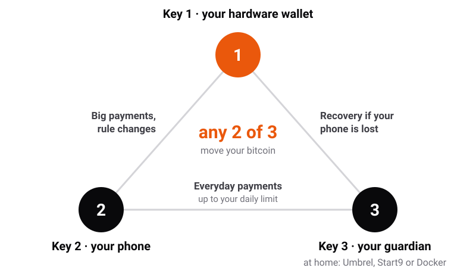
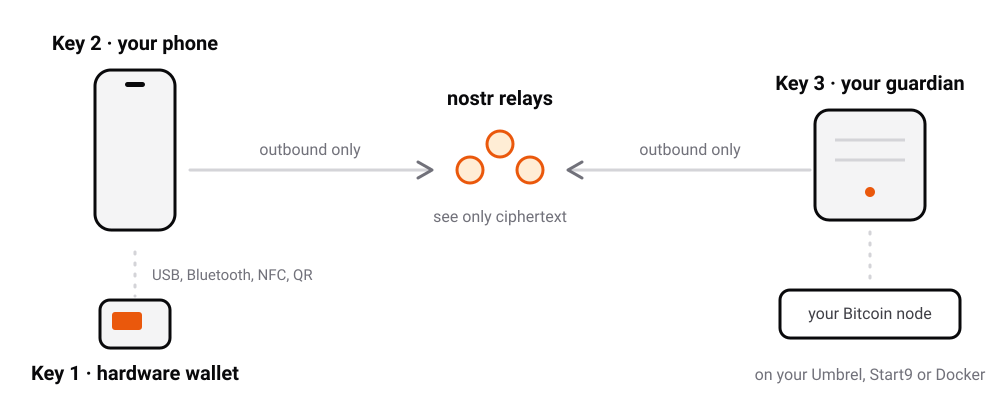
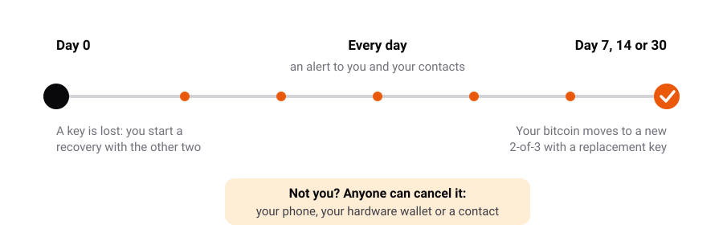
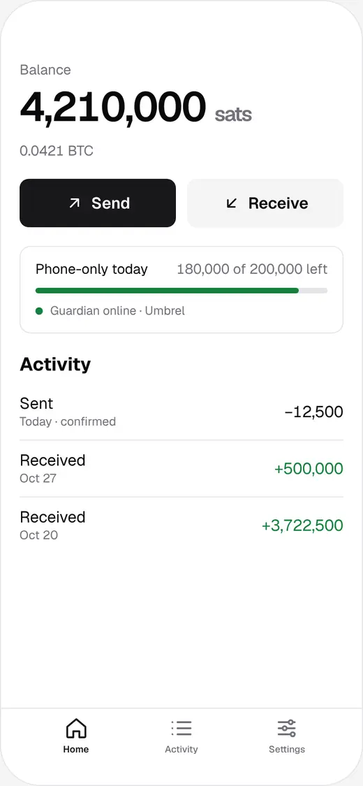
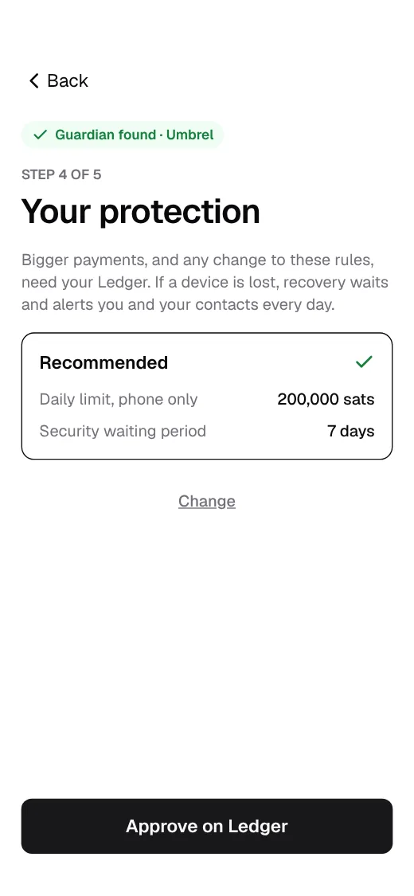
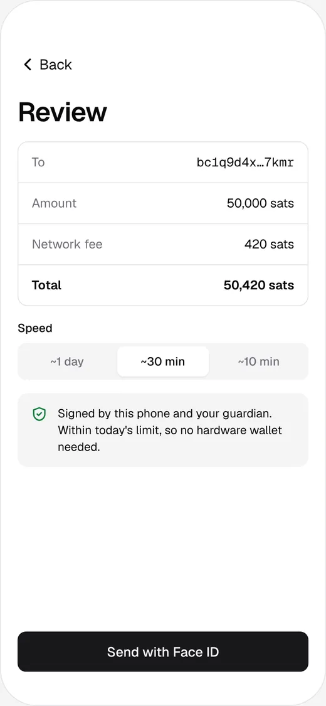
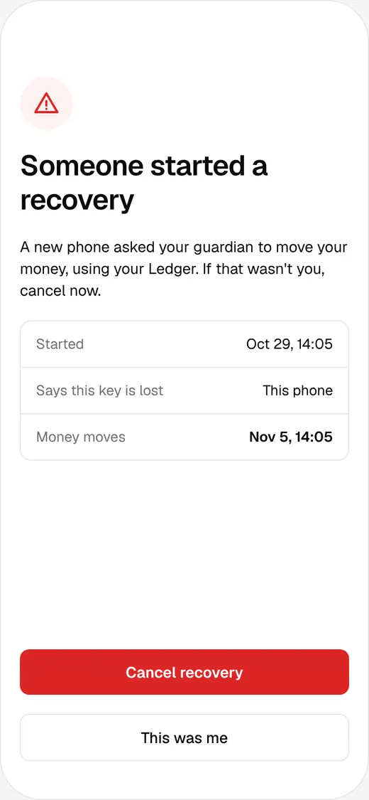

# Trikey

A 2-of-3 bitcoin wallet that feels like [Bitkey](https://bitkey.world), with no
company holding a key. Website: [trikey.app](https://trikey.app).

<p align="center">
<picture>
  <source media="(prefers-color-scheme: dark)" srcset="docs/img/readme/keys-dark.svg">
  
</picture>
</p>

| Key | Where it lives | Used for |
|---|---|---|
| 1 | **Any hardware wallet** (Ledger, Trezor, Coldcard, BitBox, Jade…) | Big payments, changing rules, recovery |
| 2 | **Your phone**, backed up to your own cloud | Everyday payments |
| 3 | **Trikey Guardian** on your own Umbrel or Start9, or on plain Docker ([`packaging/compose`](packaging/compose/README.md): a Mac, a PC, Linux, a NAS) | Co-signs phone payments under a daily limit; runs a 7-day Delay & Notify recovery |

Any two keys move money. The guardian only co-signs what its rules allow, it
talks to your phone over encrypted nostr relays, and it never opens a port on
your home network.

No home server? **Recovery Key mode** keeps key 3 offline (a printed kit, an NFC
card or a second hardware wallet) and gives the phone a small spending balance
refilled by pre-signed, timelocked refills.

> **Status: pre-alpha.** Not audited. Use testnet, signet or regtest. The app also
> offers mainnet in guardian mode, behind a warning, for testing at your own risk with
> an amount you can afford to lose; Recovery Key mode is test networks only.

## How it works

<p align="center">
<picture>
  <source media="(prefers-color-scheme: dark)" srcset="docs/img/readme/network-dark.svg">
  
</picture>
</p>

- Wallets are plain `wsh(sortedmulti(2, …))` descriptors on BIP48 paths, so any
  multisig-capable wallet can recover them without Trikey.
- The guardian checks every request against the descriptor, a rolling 24-hour
  limit and the rules you set with your hardware wallet.
- Losing a device starts a recovery that waits 7, 14 or 30 days and alerts you
  and your contacts every day. Any of them can cancel it.

<p align="center">
<picture>
  <source media="(prefers-color-scheme: dark)" srcset="docs/img/readme/recovery-dark.svg">
  
</picture>
</p>

The full design, threat model and open questions are in [DESIGN.md](DESIGN.md). What stands between this alpha and a beta: [docs/beta-checklist.md](docs/beta-checklist.md).

### In the app

<p align="center">
<picture><source media="(prefers-color-scheme: dark)" srcset="site/img/phone-home-dark.webp"></picture>
<picture><source media="(prefers-color-scheme: dark)" srcset="site/img/phone-onb-limit-dark.webp"></picture>
<picture><source media="(prefers-color-scheme: dark)" srcset="site/img/phone-send-review-dark.webp"></picture>
<picture><source media="(prefers-color-scheme: dark)" srcset="site/img/phone-recovery-alert-dark.webp"></picture>
</p>

## Install (alpha test builds)

**The guardian (key 3):**

- **Umbrel:** add the community app store `https://github.com/TheIcarusWings/trikey-umbrel-store` (App Store, ⋯, Community
  App Stores), then install **Trikey Guardian**. Each release pins the image by its digest.
- **Plain Docker** (a Mac, a PC, Linux, a NAS): the `trikey-guardian-compose.yml` attached to each
  [release](https://github.com/TheIcarusWings/trikey/releases), which pins the image by its digest
  ([packaging/compose/README.md](packaging/compose/README.md)).
- **Start9:** no package is published yet; you can build it yourself ([packaging/start9](packaging/start9/README.md)).

The image is reproducible: [packaging/VERIFY.md](packaging/VERIFY.md) shows how to rebuild it and get the same digest.

**The app (key 2):**

- **iPhone:** not in the App Store yet; build it from source with a free Apple ID
  ([apps/mobile/README.md](apps/mobile/README.md)).
- **Android:** every [GitHub release](https://github.com/TheIcarusWings/trikey/releases) has two apps. Get them from
  [Zapstore](docs/zapstore.md) (search **Trikey**; both are listed) or with Obtainium
  (**[add to Obtainium in one tap](https://trikey.app/obtainium)**), which keep them up to date. Both are signed with the same release key; its certificate is in
  [packaging/android/release-cert.sha256](packaging/android/release-cert.sha256).
  - **Trikey** (`trikey-alpha-v<version>.apk`, `app.trikey.wallet`): the standard build, with Google's libraries.
  - **Trikey FOSS** (`trikey-alpha-foss-v<version>.apk`, `app.trikey.wallet.foss`): no Google code, for phones without
    Google Play services.

Both Android apps can be on one phone, each with its own wallet. Had the no-Google APK of 0.1.21-alpha or earlier? It was the same
app as Trikey, so the new Trikey FOSS installs next to it and starts empty: restore your backup file and recovery code
in it, then uninstall the old one ([how](docs/android-signing.md#moving-from-the-no-google-apk-of-0121-alpha-or-earlier)).
Want to help test? Start with [docs/testers.md](docs/testers.md); the full steps are in [docs/alpha-test-plan.md](docs/alpha-test-plan.md).

## Repository

| Path | What it is |
|---|---|
| `packages/core` | Descriptors, BIP48 2-of-3 wallets, PSBT building and checks |
| `packages/wallet` | The phone's wallet logic: pairing, payments, recovery, hardware wallets, backups |
| `packages/protocol` | Nostr RPC between the phone and the guardian |
| `packages/recovery-key` | Recovery Key mode (key 3 offline, pre-signed refills) |
| `packages/silent-payments` | Silent payments (BIP 352) |
| `apps/guardian` | The guardian service |
| `apps/guardian-web` | The guardian's web UI |
| `apps/mobile` | The React Native app (iOS and Android) |
| `packaging/` | Docker image, Umbrel app, Start9 package, and Docker Compose for everything else (`packaging/compose/`) |
| `tools/consensus-verify` | Checks transactions with Bitcoin Core's script verifier |
| `e2e/` | End-to-end tests against regtest bitcoind and Electrs |
| `docs/`, `site/` | Design notes and guides; the website |

## Development

Node.js 22 (`.nvmrc`):

```sh
npm install
npm run typecheck
npm test
```

See [CONTRIBUTING.md](CONTRIBUTING.md). Report security issues privately as
described in [SECURITY.md](SECURITY.md).

## Support

Trikey has no company behind it. It's an open source project (MIT), built in public.
Donations pay for one thing: the Google Play and Apple developer accounts, so people can
install Trikey from the stores like any other app. They go to one public bitcoin address,
so anyone can see what comes in: donations are public.

```
bc1qktf58cunadszkd2hq8uttrtezcm7nj3mwurw2z
```

Please read before donating: you get nothing in return. There are no guarantees: you're
trusting the founder to spend it on the project. Treat it as money you've lost, and only
give what you'd be fine never seeing again.

## License

[MIT](LICENSE)
